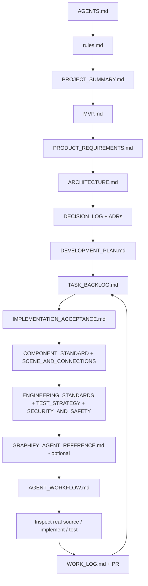

# Agent Entry Map — Who Reads What and When

Start at **[AGENTS.md](../AGENTS.md)**. It is the normative entry point, not this map. This file removes ambiguity about file relationships and keeps reference reading targeted.

## Task-specific minimum path
- **Any session:** AGENTS → rules → summary → MVP → backlog → affected acceptance/ADR → source → tests → work log.
- **Port/snapping/routing:** additionally SCENE_AND_CONNECTIONS, COMPONENT_STANDARD, architecture, graph-related tasks T-003,T-004,T-007–T-009.
- **Editor/undo/import:** schema + architecture + T-005,T-010–T-012.
- **Animations:** graph/flow inputs + T-013–T-015; no invented process measurements.
- **Host data:** architecture/quality + T-016,T-017; SDK opens **no** network connection.
- **Build/release:** T-001,T-002 and T-023,T-024; tests/packaging docs; no Graphify prerequisite.
- **Graphify tooling:** GRAPHIFY_AGENT_REFERENCE and T-027; use source verification.

## Current source-link map (validate against checked-out HEAD)
`apps/playground/src/main.tsx` → `packages/react/src/index.tsx` → `packages/components/src/index.ts` and `packages/core/src/index.ts`.

## Agent startup algorithm
1. Read AGENTS + scope docs, identify current git branch and real task status.
2. Select earliest unblocked task with accepted prerequisites; announce objective and acceptance criteria.
3. If local Graphify is fresh, query exact relevant symbols; else use targeted source search.
4. Inspect real source and test fixtures, design smallest vertical implementation.
5. Run verification, update docs/backlog, append work log and open a small PR.
6. Hand off with exact commit, commands and PASS/FAIL/NOT RUN. Continue only after previous dependencies accepted.
