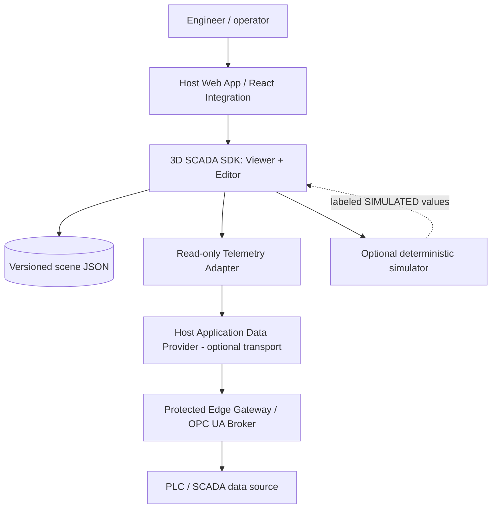
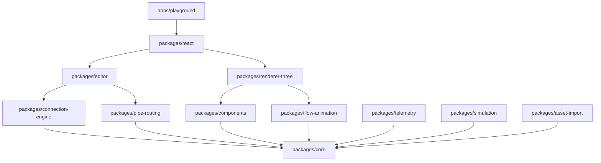
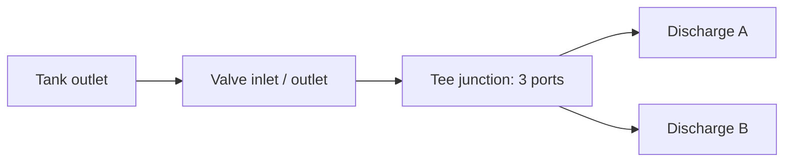

# 3D SCADA SDK — System Architecture

**Status:** target architecture and implementation contract; NOT a statement that all modules exist.  
**Scope:** reusable industrial 3D scene SDK, standalone playground, embeddable React editor and viewer.  
**Authority:** `AGENTS.md`, `rules.md`, accepted ADRs, `docs/PRODUCT_REQUIREMENTS.md`, `docs/DEVELOPMENT_PLAN.md`.  
**Last reviewed:** 2026-10-15.

## 1. Architecture goals and non-goals

The SDK enables integrators to compose industrial equipment (tanks, silos, valves, pipes, elbows, tee junctions, pumps, motors and sensors) into **explicit connected 3D networks**; visualize fluid, temperature and state; author and persist scenes; and bind quality-tagged readings to models.

**Guiding invariants:** (1) topology is data, not spatial overlap; (2) framework-neutral semantic core; (3) real, simulated and unknown process values are distinct; (4) editor state does not pollute persisted process scenes; (5) packages can be published and integrated without Z-Factory; (6) no direct PLC command/write path in the SDK MVP.

Non-goals: certified SCADA/functional safety system, PLC runtime/emulation, unrestricted SVG-to-accurate-CAD conversion, production CFD, safety interlocks, autonomous process control.

## 2. Context, domains and trust boundaries



The browser is **untrusted for industrial control**. The host handles auth, tenant isolation, network authorization, credential storage, audit and data transport. PLC/OPC UA sits behind a trusted backend or edge gateway. SDK data input is observation-only and transport-independent. Future control must be separately designed, threat-modeled, reviewed and authorized.

## 3. Layered architecture and dependency direction



**This is a logical target dependency view**, not yet an enforced package graph. Avoid cycles, including through barrel imports. New adapters must depend inward on core contracts; core never imports React, Three.js, WebGL, DOM, telemetry transport or Z-Factory.

### Packages and ownership

| Module | Owns | Must not own |
|---|---|---|
| `core` | scene/instance/port types, units, schema validation, IDs, world transforms, scene migrations | React/UI, raw PLC access |
| `components` | component definitions, metadata, param schemas, procedural geometry descriptors, asset mapping | connection graph mutation |
| `connection-engine` | validated explicit edges, port occupancy, compatibility, snapping math, graph traversal | mesh ownership or PLC transport |
| `pipe-routing` | centerline paths, waypoint constraints, elbows/tees, route validity diagnostics | process flow measurement |
| `editor` | state machine, commands/history, drag-and-drop, transform gizmos, snapping interaction, selection | authoritative live telemetry |
| `renderer-three` | materials, Three.js mesh factories, picking, labels, glass/X-ray/cutaway, GPU cleanup | scene topology authority |
| `flow-animation` | path-based visual fluid motion, tank level/heat indicators, animation scheduling | unvalidated CFD/plant commands |
| `telemetry` | optional host-driven observation inputs, tag-binding validation, quality/stale/out-of-order state | network protocols, socket lifecycle, PLC secrets or browser direct OPC UA |
| `simulation` | optional deterministic engineering equations and simulated values | measured-state claims or safety decisions |
| `asset-import` | sanitized SVG templates/extrusion and licensed glTF ingestion | inferring physically correct machinery internals from flat SVG |
| `react` | hooks, contexts, editor/viewer React API, host callbacks | domain business rules |
| `apps/playground` | demos, fixtures, R&D, feature acceptance examples | distributable SDK dependencies |

**Current packages (MVP):** `core`, `components`, `react` and `apps/playground`. Per ADR-0005 (rejected for the MVP), snapping, graph, routing, flow and telemetry live in `core` rather than separate packages; the public surface of each package is listed in [API.md](API.md). The React package temporarily includes combined renderer/editor code. The other modules are future milestones; split by tested vertical slice, never by empty directory creation. Current pipe flow is a basic indicator, not routed particle flow.

## 4. Authoritative data models

Four intentionally separate state domains:

1. **Authored SceneDocument** — schemaVersion, coordinate units, component instances, transforms, property defaults, typed explicit connection edges, optional tag binding metadata; JSON serializable, versioned, validated.
2. **Process Observations** — keyed by tag ID, typed value/unit, quality (GOOD/BAD/UNCERTAIN/STALE), timestamps, source, optional sequence; never mutates scene topology.
3. **Simulation State** — optional computed value with SIMULATED origin and model/version, separate from measured observations.
4. **Ephemeral UI/Render State** — viewport, camera, selection, hovering, gizmos, transparency preference, active tool and transient animations; not automatically serialized as plant state.

Illustrative **target** model (M1 will freeze actual contracts):

```ts
type ConnectionEndpoint = { instanceId: string; portId: string };
type ConnectionEdge = { id: string; from: ConnectionEndpoint; to: ConnectionEndpoint };

interface SceneDocument {
  schemaVersion: number;
  units: 'm';
  components: Array<{
    id: string;
    type: string;
    position: [number, number, number]; // metres
    rotation: [number, number, number, number]; // quaternion x,y,z,w
    scale: [number, number, number];
    properties: Record<string, unknown>;
  }>;
  connections: ConnectionEdge[];
}

type Observation = {
  tagId: string;
  value: boolean | number | string;
  unit?: string;
  quality: 'GOOD' | 'BAD' | 'UNCERTAIN' | 'STALE';
  sourceTimestamp: string;
  source: 'MEASURED' | 'SIMULATED';
};
```

**Implemented (T-005 → T-030):** `ScadaScene` is now version 3 (ADR-0007): `schemaVersion: 3`, `units: 'm'`, components with `type`, `position: { x, y, z }`, `rotation: { x, y, z, w }` (unit quaternion), `scale: { x, y, z }`, plus optional `tagBindings` (ADR-0006). Version 2 files (array vectors) and version 1 files (`version: 1`, `kind`, Euler XYZ) migrate on load; saves always write version 3.

Geometry coordinates: right-handed, **Y up**, metres; angles in radians. Ports use local-space coordinates and **outward normals**. Nonuniform scaling of connected parts requires an explicit documented restriction or transform policy. Flow/volume units must be converted explicitly (litres vs cubic metres, pressure and temperature) at typed boundaries.

## 5. Component contract / library

Every component definition must provide: stable type ID/version; category/name; validated editable properties and defaults; dimensions/bounds; geometry/asset factory; material variants; typed ports, local positions and outward normals; nominal bore, port limits and compatibility rules; optional telemetry bindings and animations; cleanup; fixtures; preview/demo.

Examples:
- Tank: inlet/outlet/drain, shell and interior liquid surface, level and temperature.
- Ball valve: fluid inlet/outlet; stem/handle visual, open/closed state distinct from confirmed rate.
- Tee: three fluid connection ports with real junction geometry, not crossed independent pipe meshes.
- Pump/motor: process and mechanical semantics distinct; animated rotor does not prove actual operation.

Procedural Three.js geometry and GLB/glTF assets are primary 3D paths. SVGs may be used for reference, selected path extrusion or template-assisted revolution, subject to sanitization and licensing. An SVG alone cannot automatically reveal internal geometry or mechanical connectivity.

**Implemented (T-019a, ADR-0012):** `packages/asset-import` (`@scada3d/asset-import`):
- an allow-list SVG sanitizer with its own XML tokenizer (no DOM, no entity expansion);
- a flat shape model and `toSvgMarkup`;
- a scene `underlay` drawn on the ground plane as a tracing reference.

Extrusion into custom parts is T-047 (part b).

## 6. Connection graph and world-space snapping

A **logical connection** always connects `instanceId + portId` to another compatible endpoint, independent of displayed pipes.



### Validation invariants
- Unique instance/edge IDs; every endpoint resolves to an existing declared port.
- Compatible domain, nominal diameter, occupancy/capacity, alignment and opposed normals.
- Preserve separate electrical, fluid, signal and mechanical domains.
- Graph traversal supports tees, splits, loops and disconnected groups; never infinite traversal.
- Delete/disconnect is transactional and leaves no dangling edges.
- Graph edges survive move/rotate, serialization and undo/redo; geometry is derived from topology + transforms.

### Snap transaction
1. Raycast pointer to work plane/surface; project dragged component's candidate port into world space.
2. Filter nearby ports by domain, bore, availability and orientation; deterministic ordering.
3. Display valid/invalid preview and reason; allow explicit cancel.
4. Solve dragged transform to coincide anchors while outward normals oppose.
5. Validate all affected edges, commit one editor command, re-route affected pipes and record history.
6. On invalid state, roll back atomically.

Routing starts with deterministic straight/orthogonal centerlines, bend-radius and bore constraints; fitting geometry derived after route solving. Report collisions or unsatisfiable geometry explicitly. Obstacle avoidance and CAD-grade clearance verification require separate research/performance work.

## 7. Editor architecture and persistence

User event -> tool state machine -> validated command -> immutable scene update -> derived route/mesh -> render. Commands: `AddComponent`, `DeleteComponent`, `TransformComponent`, `SetProperty`, `ConnectPorts`, `DisconnectPorts`, `ImportScene`.

Undo/redo stores semantic operations or immutable snapshots with bounded history; pointer dragging is coalesced to **one** history step. Gizmos use Three TransformControls (or equivalent adapter), with orbit disabled during manipulation and snap thresholds tested. Scene import is schema-validated and size-limited; supported migrations are explicit; failed imports do not mutate the current scene. Save/load is deterministic, and no live observation is accidentally persisted as authored topology.

Public React API (proposed, subject to M7 contract review): `Scada3DEditor`, `Scada3DViewer`, `ComponentPalette`, `useTelemetry`, `onSceneChange`, `onSelectionChange`, `onValidationError`. Headless consumers use core/scene/graph APIs without React.

## 8. Process visualization, flow and simulation

**Flow mode:** Graph + per-edge signed rate/direction/quality -> flow resolver -> path sampling -> GPU-efficient shader motion/instanced particles. A rate of zero pauses motion, a negative rate reverses; missing/stale/bad data shows unknown/unavailable, not arbitrary flowing animation. Tee split values require measurements or clearly labeled simulation.

**Implemented (T-013):** `resolveFlow(scene, readings, { now, source?, staleAfterMs?, maxClockSkewMs?, zeroThreshold? })` in `packages/core/src/flow.ts`. Readings are `{ connectionId, rate (m³/s, + = from→to), quality, source, sourceTimestamp (ISO 8601) }`, keyed by connection id until tag bindings exist (T-016). One `FlowState` per connection: `forward`/`reverse`/`stopped` (|rate| ≤ 1e-6 by default) with `uncertain` for UNCERTAIN quality, or `unknown` with `NO_READING`, `BAD_QUALITY`, `STALE` (flagged, or older than 10 s), `INVALID_TIMESTAMP` (unparseable or > 5 s in the future) or `INVALID_VALUE`. The newest reading per connection wins regardless of arrival order. Measured and simulated readings are never mixed: the caller picks one source (default MEASURED). Valve state and topology are never used to infer flow; tee branches stay unknown without their own reading. `now` is a parameter, so core stays pure. Rendering is T-014.

**Implemented (T-014):** `Scada3DViewer` and `Scada3DEditor` take an optional `flow: { readings, source?, staleAfterMs? }`; without it no flow is drawn at all. The viewer resolves states with `resolveFlow` against a clock refreshed every second (so readings age into STALE without new data) and draws per routed connection: instanced beads slightly wider than the pipe that travel along `sampleRouteCenterline` (bend arcs, not corners) from→to for forward and to→from for reverse, driven by frame delta at a fixed visual speed of 0.8 m/s (**not** proportional to the rate); still beads for stopped; dimmed beads for UNCERTAIN; violet beads plus a "SIMULATED FLOW" badge in simulated mode; and a dashed overlay drawn above geometry for unknown (amber stale, red bad quality, light grey no reading/invalid). A text summary (`aria-label="Flow summary"`) counts each state. The old manual "Flow indicator" checkbox was removed because it showed flow without data. The playground `?demo` adds a demo flow feed panel acting as the host (rate/quality per connection, source, Live re-stamping).

**Tank mode:** level drives a bounded liquid volume mesh (0–100%), including normal/glass/X-ray visibility; temperature can color-code heat with legend and units. Heating visuals are metaphors unless simulation provides validated physical state.

**Display modes:** opaque, glass and X-ray material modes plus optional clipping/cutaway; resource reuse/disposal and transparency ordering are tested. A glass toggle affects display state, never live plant properties.

**Implemented (T-015):** `packages/react/src/appearance.ts` holds the display rules. View modes `normal`, `glass` (shell opacity 0.21, no depth write so the liquid stays visible), `xray` (opacity 0.06 plus edge outlines) and `cutaway` (opaque shell with a world-space clipping plane removing the +Z half through the component origin; liquid left whole). The viewer takes `viewMode` and `viewOverrides` (per-component); the editor has a global View select and a per-component "Component view" select, held only in editor state and never saved. Routed pipes follow glass/x-ray and stay whole in cutaway. **Level policy (`liquidFill`):** a finite percent is clamped to 0–100 and flagged in the properties panel when outside; a missing or non-numeric level draws no liquid (no assumed default). **Heat:** a tank `temperature` property (°C) tints the liquid from blue at 0 °C to red at 100 °C (clamped), with a legend reading "display only, not simulated". `Scada3DViewer`'s boolean `glass` prop was replaced by `viewMode`.

**Optional engineering simulator:** fixed-time-step tank mass-balance, bounded volume and documented pressure/valve/pump models, input assumptions, fixtures and validation tolerances. Always label results **SIMULATED**. Real CFD/particle fluid physics is not included in initial release; separate ADR and specialized solver evaluation required.

**Implemented (T-021, ADR-0010):** `packages/simulation` (`@scada3d/simulation`, depends on core and components). Model `mass-balance` v1:
- gravity drain through open paths (Torricelli, Cd 0.62, discharge to atmosphere, no friction or back-pressure);
- feeds at free ports, and pumps forcing their rate from the first tank upstream;
- equal tee splits; closed valves and stopped pumps block;
- explicit Euler in 0.1 s steps.

It is verified against the analytic drain solution (< 0.5 %, measured 0.04 %) and volume conservation. The viewer's `simulation` prop draws its levels and flows, never mixed with measured values. **Implemented (T-022, ADR-0011):** model `hydraulic` v1 in the same package.
- Each step it solves the junction heads (Gauss–Seidel with Illinois root-finding), then integrates the volumes.
- Physics: Darcy–Weisbach friction (Swamee–Jain, within 2 % of Colebrook–White for the catalog's pipes), K-factor fittings, quadratic pump curves with a built-in check valve, and elevations from world positions.
- Tree networks only; loops are reported.
- Verified against independent energy-equation solutions (< 1 %), tank equalisation and the pump operating point.

## 9. Telemetry and data adapters

```mermaid
sequenceDiagram
  participant PLC as PLC/OT data source
  participant Edge as Secure Edge/Host backend
  participant Adapter as SDK telemetry adapter
  participant VM as View model
  participant R as Three.js Renderer
  PLC->>Edge: OPC UA / device-native reads
  Edge->>Adapter: Observations via host-selected integration
  Adapter->>VM: normalized values + quality + timestamp
  VM->>R: render projection and state changes
  Note over Adapter,R: Read-only browser SDK; no direct PLC writes
```

**Transport is not an SDK prerequisite.** SDK exposes a host-driven data-input contract; applications can pass an initial snapshot, call `setTagValues(observations)`, or implement an optional `DataProvider` subscription. No SDK-managed WebSocket, MQTT client, broker, cloud endpoint or OPC UA connection is required for rendering, editing, persistence or simulation. Data can originate from REST polling, application stores, IPC, files, simulator, WebSocket, MQTT or backend OPC UA bridge **outside the SDK**. The host owns connection, authentication, reconnection and network error handling. SDK owns observation validation, tag-to-component mapping, freshness/quality indications and update/disposal behavior.

Proposed interface (API name not finalized):
```ts
type Quality = 'GOOD' | 'BAD' | 'UNCERTAIN' | 'STALE';
type Observation = { tagId:string; value:number | boolean | string; sourceTimestamp:string; quality:Quality; unit?:string; source?:'MEASURED' | 'SIMULATED' };
interface DataProvider {
  getSnapshot?(): Observation[] | Promise<Observation[]>;
  subscribe?(onData:(observations:Observation[])=>void): () => void;
}
```
**Implemented (T-016):** `resolveTelemetry(scene, observations, { now, source?, staleAfterMs?, resolveBindable? })` in `packages/core/src/telemetry.ts`. Observations are `{ tagId, value, quality, sourceTimestamp, source?, unit? }`. Per tag the newest observation of the chosen source wins; property bindings resolve to a trusted canonical value (unit converted via `units.ts`: K/°F → °C, m³/h, L/s, L/min → m³/s) or `unknown` with `NO_READING`, `BAD_QUALITY`, `STALE`, `INVALID_TIMESTAMP`, `INVALID_VALUE` or `INVALID_UNIT`; flow bindings become `FlowReading`s for `resolveFlow`. Quality/timestamp rules are shared with flow in `observation.ts`. `displayScene` produces the drawn copy: trusted values replace authored ones and untrusted bound properties are removed (liquid hidden, valve ball grey) so authored defaults are never shown as live. Viewer/editor prop `telemetry: { observations, source?, staleAfterMs? }`; overlay "Tags: …" summary; editor "Tag bindings" fields (commit on Enter/blur, one undo step each) and a "Live values" list. Playground `?demo` binds LT-101, TT-101, XV-101 and FT-101…104 and feeds them from a demo tag panel. The provider/subscription API and no-network/cleanup tests are T-017.

**Implemented (T-017):** `packages/core/src/dataInput.ts`: `DataProvider` (`getSnapshot?` sync or async, `subscribe?` returning an unsubscribe), `createObservationStore` (newest observation per tag and source, late older values ignored, bounded by `maxTags` default 50,000, stable snapshot array, change listeners) and `connectProvider` (snapshot plus pushed batches; disconnect unsubscribes exactly once and drops anything arriving afterwards, including a late async snapshot; provider errors go to `onError` instead of throwing). React: `telemetry.provider` is subscribed on mount and released on unmount, and `Scada3DViewer`/`Scada3DEditor` accept a `ref` exposing `ScadaHandle.setTagValues`; direct `observations`, provider batches and pushed values merge into one telemetry input. Browser tests prove one subscription per mounted viewer/editor, release on unmount across repeated mounts and with two viewers, and **no fetch, XHR, WebSocket, EventSource or beacon** in plain, demo and provider modes (the detectors were checked to catch a deliberate fetch and socket).

An app may instead invoke an imperative `setTagValues` API. Tests must prove editor/viewer work without any provider and accept host-supplied updates without opening sockets. If observation timestamps stop advancing, SDK marks values stale by documented policy without requiring knowledge of transport connectivity.

## 10. Performance, security and reliability

- Profile on named benchmark scenes; evaluate draw calls, frame time, geometry memory, GPU buffers and heap leak after repeated editor mounts.
- Use geometry/material pooling or instancing where appropriate, LOD for distant effects, adaptive particle budgets and update coalescing.
- Strict TypeScript; public typed exports; pure unit-testable core; no uncontrolled global state; deterministic algorithm tests.
- Validate scene JSON limits (object count, nesting, sizes), URLs and SVG imports; reject active scripts/external references, untrusted glTF resources and oversized assets.
- No credentials/PLC IPs bundled into browser. No unsafe remote command transport. No claim of IEC 62443 certification.
- Errors are typed/observable and recoverable; render failures do not modify persistent scene; reconnection restores observations without mutating topology.
- Tests: schema/property/transform math, graph edge cases, routing, animation quality, simulated conservation, browser editor scenarios, security fuzz fixtures, resource disposal and consumer-app integration.

## 11. Agent development knowledge graph (Graphify)

Agents start with `AGENTS.md` and `rules.md`. When a **fresh local Graphify index** is available, use narrow source-linked graph queries for symbol owners, dependency impact and callers before reading targeted files. Verify inferred edges against actual source; never use a graph as authority over ADRs or runtime evidence. After change, refresh graph, re-query affected paths and record queries/freshness in `docs/WORK_LOG.md`. Private source code is not uploaded to hosted indexes without explicit owner approval. When Graphify isn't installed, fall back to targeted repository search; development is not blocked.

Detailed setup and query discipline: `docs/GRAPHIFY_AGENT_REFERENCE.md`. Tooling readiness tracked as T-027. **Token savings are a hypothesis until measured.**

## 12. Delivery alignment and quality gates

| Phase | Architectural gate |
|---|---|
| M0 | clean install/build/typecheck/CI |
| M1 | validated and migratable scene schema, world-port transforms |
| M2 | accurate and resource-safe geometry |
| M3 | deterministic snapping, graph, routing, tee/loop tests |
| M4 | editor operations, gizmos, undo, JSON roundtrip browser tests |
| M5 | flow quality and direction, level, material-mode rendering tests |
| M6 | no-network viewer tests, host-driven data-input lifecycle, stale/out-of-order tests |
| M7 | SVG/glTF pipeline, bounded optional simulation, hardening |
| M8 | standalone consumer package integration and release validation |

Use `docs/DEVELOPMENT_PLAN.md`, `docs/TASK_BACKLOG.md`, `docs/IMPLEMENTATION_ACCEPTANCE.md`, `docs/AGENT_WORKFLOW.md`, and `docs/WORK_LOG.md` for actionable tasks and evidence. Architecture or schema reversals require a proposed and accepted ADR.

## 13. Current implementation vs target

**Implemented in bootstrap (not yet build-verified):** core TypeScript types and scene factory; basic catalog; React Three Fiber tank, valve, pipe, tee, pump/motor/sensor placeholders; drag-to-add; simple level slider; basic glass toggle; manually toggled pipe flow indicator; playground.

**Not implemented / not verified:** port snapping; validated connection graph edit UI; physical pipe routing; directional particle-based water animations; robust imported scene schema and migrations; command history; rotation gizmos; authentic X-ray/cutaway; engineering physics; SVG import; telemetry adapters; published package and CI acceptance. Treat each as a planned milestone until tests and PR evidence prove otherwise.
