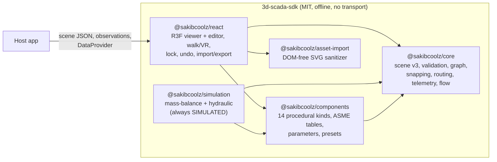
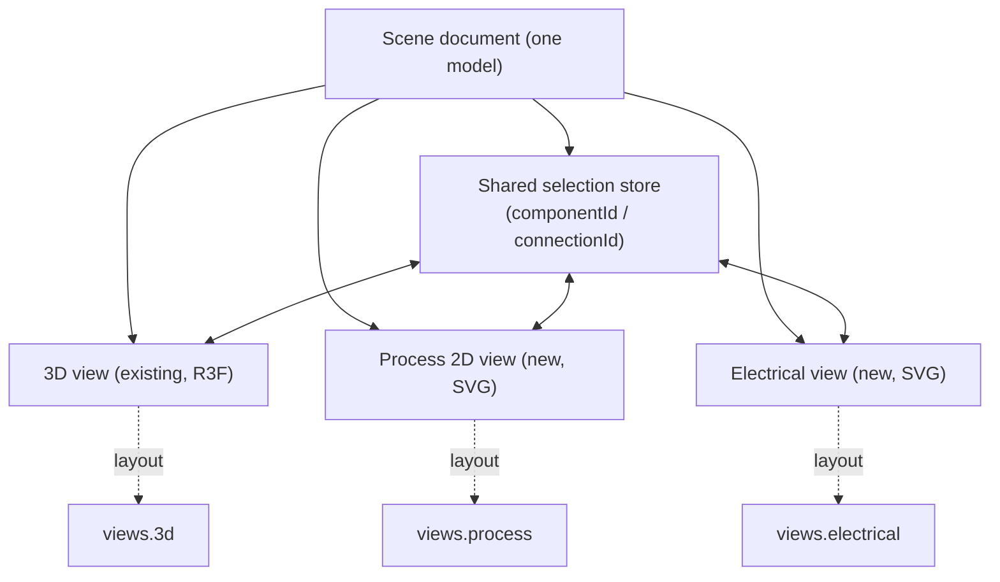
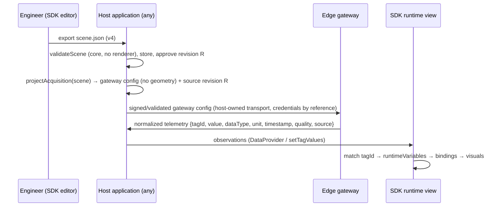

# Industrial SDK: Repository Audit, Gap Analysis and Phased Plan

Status: **Accepted by the owner, 2026-10-22** (T-067); decisions D1–D7 recorded in §11. Nothing in this document is implemented yet unless it is marked IMPLEMENTED.
Baseline: `develop` at `db9d408` (after PR #68). Published packages: `@sakibcoolz/*` 0.1.3.

This document answers the "first response" of the owner's master development prompt. It covers:
- the audit;
- the gap analysis;
- the proposed architecture and JSON model;
- breaking changes and how compatibility is kept;
- the phases with acceptance criteria;
- the decisions the owner must make before code starts.

After approval, the topic documents the prompt names (except Z_FACTORY_INTEGRATION.md, dropped by decision D6) will be written phase by phase, as the code lands; section 12 lists where each one goes. Writing them all now, before review, would only create churn.

Status labels used throughout:
- **IMPLEMENTED**: present in code and covered by tests.
- **PARTIAL**: some code exists, but it falls short of the target.
- **NOT IMPLEMENTED**: no code.
- **NOT VERIFIED**: claimed in the docs, but not checked in code or tests.

---

## 1. Current SDK architecture summary



- **Layering** (ADR-0001, ADR-0005):
  - core has no dependencies and no React, Three.js, DOM or transport code;
  - components depends only on core;
  - react holds the renderer and the editor.
  - The packages ARCHITECTURE §3 lists as targets (`connection-engine`, `renderer-three`, `telemetry`, …) do not exist. That is a deliberate MVP choice: their code lives in core and react.
- **One authored document**, `ScadaScene` v3 (ADR-0007), kept separate from observations, simulation state and UI state (ARCHITECTURE §4). IMPLEMENTED.
- **Explicit topology**: connections join `instanceId` and `portId`, and ports come from the catalog through injected resolvers; topology is never guessed from overlapping geometry (ADR-0002). IMPLEMENTED.
- **Read-only telemetry** (ADR-0003): the host pushes observations, and the SDK never writes or opens a network connection. IMPLEMENTED.

## 2. Existing feature inventory

### 2.1 Scene document and validation (core)
| Capability | Status | Evidence |
|---|---|---|
| Versioned scene (`schemaVersion: 3`, `units: 'm'`) | IMPLEMENTED | `core/src/scene.ts:68,86-95` |
| Migration v1/v2 → v3 on load (`migratedFrom`) | IMPLEMENTED | `validation.ts:586-627`, migration tests (14) |
| Strict validation: unknown fields rejected, never repaired; 25 error codes with paths | IMPLEMENTED | `validation.ts:21-53,140-146` |
| Deterministic serialization (fixed key order, sorted properties, byte-stable round trip) | IMPLEMENTED | `serialization.ts:15-58`, tests; e2e `import-export` |
| Resource limits (10k components, 20k connections, 10 MB parse cap) | IMPLEMENTED | `validation.ts:71-79`, `serialization.ts:62` |
| Hostile-input hardening (3000 seeded mutations, prototype pollution, deep nesting) | IMPLEMENTED | `security.test.ts` |
| Formal JSON Schema file | NOT IMPLEMENTED | none in the repository |
| Project metadata, views, assets, data sources, custom fields | NOT IMPLEMENTED | `ScadaScene` has none of these |
| Catalog-geometry upgrade (`upgradeDimensions`, ADR-0014) | IMPLEMENTED | `upgrade.ts:54-103` |

### 2.2 Components and registry
| Capability | Status | Evidence |
|---|---|---|
| 14 procedural kinds (tanks ×5, pipe, elbow, tee, valve, reducer, coupler, pump, sensor, motor) | IMPLEMENTED | `components/src/catalog.ts:499-531` |
| Parametric definitions (number/choice parameters, ranges, presets) | IMPLEMENTED | `geometry.ts:38-57`, `parameters.ts`, `vessel.ts:146` |
| Register a custom kind **without editing the SDK** | NOT IMPLEMENTED | `componentKinds` is a closed `as const` tuple (`scene.ts:26`), anything else is `UNKNOWN_COMPONENT_KIND` (`validation.ts:298`), and `componentCatalog` is a `Record<ComponentKind,…>`. The PRD persona 5 and FR-01/FR-12 claims are **not met** in code. |
| Component definition version, manufacturer, model, identification metadata | NOT IMPLEMENTED | instance fields are `id, type, parentId?, position, rotation, scale, properties` |
| Sensor and motor semantics | PARTIAL | geometry only, `ports: []`; the code comment calls them placeholders (`catalog.ts:513`) |
| PLC, DCS, VFD, I/O modules, panels, cabinets, conveyors, robots | NOT IMPLEMENTED | none |
| Reusable assemblies (parent/child, rigid move) | IMPLEMENTED | ADR-0008, `assembly.ts` |
| Imported GLB/glTF geometry | NOT IMPLEMENTED | backlog T-020 (TODO) |

### 2.3 Ports and connections
| Capability | Status | Evidence |
|---|---|---|
| Typed ports with local position, outward normal, nominal size | IMPLEMENTED | `scene.ts:19-25` |
| Port domains `fluid / electrical / signal / mechanical` | PARTIAL | the type exists (`scene.ts:18`); every catalog port is `fluid` (`catalog.ts:16-18`) |
| Electrical, communication and control metadata (signal type, voltage, channel, terminal, protocol) | NOT IMPLEMENTED | none |
| Logical (non-physical) endpoints | NOT IMPLEMENTED | every port has a 3D position |
| Compatibility: same kind, nominal size within 0.1 mm | IMPLEMENTED | `portsCompatible`, `scene.ts:99-101` |
| Connection validation (unknown instance/port, self, incompatible, duplicate edge, port occupied) | IMPLEMENTED | `validation.ts:491-542` |
| Connection domain or properties on the edge | NOT IMPLEMENTED | `SceneConnection` is `{id, from, to}` only |
| Cardinality other than one connection per port (buses, terminals with many wires) | NOT IMPLEMENTED | `PORT_OCCUPIED` is absolute |
| Graph traversal (`connectionsOf`, `reachableComponents`, `connectedGroups`) | IMPLEMENTED | `graph.ts` |
| Snapping, attach, touching-port join, open-joint markers, orthogonal routing | IMPLEMENTED | `snapping.ts`, `attach.ts`, `touching.ts`, `joints.ts`, `routing.ts` |

### 2.4 Tags and telemetry
| Capability | Status | Evidence |
|---|---|---|
| Authored tag bindings (`property` and `flow`), validated, with units | IMPLEMENTED | `scene.ts:64-66`, `validation.ts:383-429` (ADR-0006) |
| Observations with quality `GOOD/BAD/UNCERTAIN/STALE`, source `MEASURED/SIMULATED`, staleness and clock skew | IMPLEMENTED | `telemetry.ts`, `observation.ts`, `flow.ts:4-5` |
| `DataProvider` (snapshot/subscribe), observation store, imperative `setTagValues` | IMPLEMENTED | `dataInput.ts`, react `ScadaHandle` |
| Bindable quantities | PARTIAL | only `percent, temperature, boolean, flow` (`scene.ts:58`); bindable properties are tank `level`/`temperature` and valve `open` |
| Runtime variable definitions (data type, access, scaling, source device or variable, alarms) | NOT IMPLEMENTED | `tagId` is an opaque string |
| Protocol addressing (OPC UA NodeId, Modbus area/address/encoding) | NOT IMPLEMENTED | by design: the host owns transport |
| Identification and engineering tags per component | NOT IMPLEMENTED | `properties` are geometry or process parameters only |
| Write or command capability | NOT IMPLEMENTED | forbidden by ADR-0003 and AGENTS.md until a safety-boundary design is approved |

### 2.5 Views, editor and runtime
| Capability | Status | Evidence |
|---|---|---|
| 3D viewer and editor (palette, drop with snap, gizmo, undo/redo, copy/paste, import/export, SVG underlay) | IMPLEMENTED | `react/src/index.tsx`, 37 e2e specs |
| Display modes normal, glass, x-ray, cutaway (never saved) | IMPLEMENTED | `appearance.ts` |
| First-person Walk and WebXR (pick, connect, edit, place) | IMPLEMENTED (desktop) / NOT VERIFIED (headset) | ADR-0020, T-061..T-065 |
| Edit lock (blocks updates, undo, drop, delete, attach, gizmo, import) | IMPLEMENTED | `index.tsx:1161-1415`, e2e `edit-lock` (5) |
| Telemetry, flow and quality display (summaries, valve tint, stale/bad flow markers, SIMULATED badge) | IMPLEMENTED | `telemetryView.ts`, `flowVisual.ts` |
| Per-component quality or alarm highlighting | NOT IMPLEMENTED | only a valve "unknown" tint |
| 2D process (P&ID-style) view | NOT IMPLEMENTED | only the SVG underlay inside 3D |
| Electrical view | NOT IMPLEMENTED | none |
| Combined, synchronized views | NOT IMPLEMENTED | the playground's "Second viewer" re-renders the same scene; the editor's selection is internal and cannot be controlled |
| Device relationship explorer | IMPLEMENTED in the editor (T-087, ADR-0027) | Related section and control chain; runtime mode is Phase 9 |

### 2.6 Z-Factory (consumer) audit: reference only
`sakibcoolz/z-factory` at `2a04219` is public. It was read only to learn what a real host needs. **Owner decision D6: the SDK stays independent, and no Z-Factory changes are planned or made, now or later.** The facts below informed the host-neutral model; nothing in the SDK will reference Z-Factory.
- **Not integrated yet**: it does **not** depend on `@sakibcoolz/*`. It has its own GLB-based 3D view (`components/scene/factory-canvas.tsx`) and an `@xyflow/react` 2D topology designer.
- **Data model** (`prisma/schema.prisma`):
  - `DeviceModel`/`DeviceInstance` with versioned GLB assets (sha256, bounds).
  - `DeviceConnection` with typed endpoints (`DEVICE | DEVICE_IO | PLC_IO_POINT | TAG | PROTOCOL_PORT`) and relationships (`CONTROLS | DRIVES | MECHANICALLY_DRIVES | MEASURES | FEEDS_BACK_TO | COMMUNICATES_WITH | WIRED_TO`).
  - `Tag` with dataType, role, Modbus area/address, byte/word order, scale/offset, unit, `accessMode READ_ONLY|READ_WRITE` and source device/signal.
  - `TagQuality = GOOD | STALE | BAD | DISCONNECTED`.
  - Gateway, Modbus connection and tag-mapping models.
- **Live data and writes**:
  - live values reach the browser over SSE (`LiveTagReading{plcId,name,value,quality,readAt}`);
  - the host writes commands, which is correct: that is host-side.
  - Modbus TCP is implemented (in-process and in a Go edge agent); OPC UA is still planned.
- **Implication**: a real host needs typed endpoints, relationship domains, Modbus addressing and a `DISCONNECTED` quality value. The SDK's model includes these as **generic, host-neutral concepts**. Any host, Z-Factory included, can map to them on its own side; the SDK ships no Z-Factory code, types or adapters.

## 3. Missing feature analysis (gaps ranked by dependency)

1. **Open component registry**: the main blocker. Every other industrial feature needs component types that the SDK core does not hard-code.
2. **Scene document v4**: project metadata, definitions, runtime variables, data sources, views, assets and extensions, with lossless migration from v3 and a published JSON Schema.
3. **Domain-rich ports**: signal and electrical metadata, logical endpoints, cardinality, and compatibility rules per domain.
4. **Connection domains**: an explicit `domain` and `properties` on edges, association edges with no ports, and relationship traversal.
5. **Tag engine**: identification and engineering tags, runtime variables, source mappings with typed protocol addresses, suggestions, warnings.
6. **Control-equipment libraries**: PLC with racks, modules and channels; DCS; VFD; sensors and motors with real ports; panels.
7. **2D process and electrical views**, a shared selection model and a combined layout.
8. **Runtime mode**: approved-document loading, alarm and quality overlays, relationship explorer.
9. **Host and edge contracts**: acquisition-config projection, normalized telemetry including `DISCONNECTED`, and a command-*request* boundary (no execution).
10. **Hardening**: schema fixtures, migration tests, consumer and package verification, performance with the new data.

## 4. Proposed Industrial Scene document (evolve, do not replace)

**Recommendation:** make the "Industrial Scene Document" **schema version 4 of the existing scene**, not a second format.
- v3 files keep loading and migrate losslessly to v4 in `validateScene`, as v1 and v2 already do.
- `serializeScene` writes v4.
- Hosts that only use v3 features change nothing.
- The owner's `documentType: "industrial.scene"` is added as a constant field.
- The version stays the existing integer line (`schemaVersion: 4`) rather than a parallel `"1.0.0"` string. See decision D2.

```jsonc
{
  "schemaVersion": 4,
  "documentType": "industrial.scene",
  "units": "m",
  "project": { "id": "plant-7", "name": "Milk line 2", "revision": "12", "description": "…" },
  "componentDefinitions": [ /* data-only definitions shipped with the document (no code) */ ],
  "components": [
    { "id": "M-101", "name": "Feed pump motor", "type": "sdk.motor", "typeVersion": "1",
      "manufacturer": "ACME", "model": "IE3-7.5", "position": {…}, "rotation": {…}, "scale": {…},
      "properties": { "ratedPowerKw": 7.5 },
      "labels": { "assetNumber": "A-00412", "area": "Process hall" } }
  ],
  "connections": [
    { "id": "c1", "domain": "fluid", "from": { "instanceId": "T-1", "portId": "outlet" }, "to": { "instanceId": "V-1", "portId": "in" } },
    { "id": "c9", "domain": "power", "from": { "instanceId": "VFD-101", "portId": "U-V-W" }, "to": { "instanceId": "M-101", "portId": "terminals" } },
    { "id": "c10", "domain": "association", "relationship": "controls", "from": { "instanceId": "PLC-01" }, "to": { "instanceId": "VFD-101" } }
  ],
  "dataSources": [
    { "id": "ds-vfd-101", "deviceId": "VFD-101", "protocol": "modbus-tcp", "endpointRef": "host:gateway-3/vfd-101" }
  ],
  "runtimeVariables": [
    { "id": "M-101.SPEED", "name": "Motor speed", "componentId": "M-101", "dataType": "float32", "unit": "rpm",
      "access": "read",
      "source": { "dataSourceId": "ds-vfd-101", "variable": "ACTUAL_SPEED",
                  "address": { "protocol": "modbus-tcp", "area": "holding", "address": 3, "unitId": 1,
                               "encoding": "float32", "byteOrder": "big", "wordOrder": "high-first" } },
      "scaling": { "kind": "linear", "rawMin": 0, "rawMax": 3000, "min": 0, "max": 3000 } }
  ],
  "tagBindings": [
    { "id": "b1", "tagId": "M-101.SPEED", "kind": "property", "instanceId": "M-101", "property": "speed" }
  ],
  "views": {
    "3d": { "camera": { … } },
    "process": { "symbols": { "T-1": { "x": 120, "y": 80 } }, "routes": { "c1": [[…]] } },
    "electrical": { "symbols": { "PLC-01": { "x": 40, "y": 40 } } }
  },
  "assets": [ { "id": "glb-vfd", "uri": "assets/vfd.glb", "sha256": "…", "bytes": 81234 } ],
  "underlay": { … },
  "extensions": { "com.acme": { … } }
}
```

Rules:
- **Stable IDs.** IDs are strings, unique within their collection, and never renumbered by the SDK.
  - Component IDs and connection IDs keep the current rules.
  - Port IDs come from the definition.
  - `runtimeVariables[].id` is the **tag ID** that observations carry.
- **Credentials are never stored.** `dataSources[].endpointRef` is an opaque host reference. Validation rejects keys named like secrets (`password`, `token`, `secret`, `apiKey`) anywhere in `dataSources` or `extensions`.
- **No live values.** Observations stay outside the document (ARCHITECTURE §4).
- **No code.** `componentDefinitions` are data only: ports, parameter schema, bindable variables, primitive geometry or an asset reference, and a 2D symbol reference. Code that builds geometry is registered by the host at runtime and never comes from JSON.
- **Assets are referenced, not embedded.**
  - Each reference carries a SHA-256 hash and size, so the document stays one JSON file.
  - Hosts load assets only from an allow-list; the existing SECURITY rule for remote glTF applies.
  - A package format (zip with `scene.json` plus `assets/`) is documented, not required.
- **Extensions** are namespaced by reverse-DNS key. They are preserved on round trip and validated only by registered extension validators.
- **Deterministic serialization** extends to the new sections: fixed key order, collections in authored order, sorted object keys inside `properties`, `labels` and `extensions`.
- **JSON Schema** (draft 2020-12) is published as `packages/core/schema/industrial-scene.v4.schema.json`, with valid and invalid fixtures. The TypeScript validator stays authoritative. A test proves the schema and the validator agree on every fixture (decision D3).
- **Validation without the renderer**: `validateScene` stays in core, which has no dependencies. IMPLEMENTED today for v3; v4 keeps it that way.

## 5. Proposed equipment and tag model

### 5.1 Registry (core, no hard-coded kinds)

```ts
interface ComponentTypeDefinition {
  typeId: string;            // namespaced: 'sdk.tank', 'sdk.vfd', 'acme.press-200'
  typeVersion: string;       // definition version, recorded on instances
  label: string;
  category?: string;         // 'vessel' | 'piping' | 'electrical' | 'control' | 'instrument' | …
  parameters?: Record<string, ParameterSpec>;   // existing NumberParameterSpec / ChoiceParameterSpec
  ports: PortDefinition[] | ((properties) => PortDefinition[]);
  variables?: VariableTemplate[];               // e.g. VFD: ACTUAL_SPEED, OUTPUT_FREQUENCY, FAULT …
  bounds?: …; geometry3D?: GeometryReference; symbol2D?: SymbolReference; electricalSymbol?: SymbolReference;
}
interface ComponentRegistry { get(typeId: string, version?: string): ComponentTypeDefinition | undefined; list(): … }
```

- `validateScene` asks the injected registry instead of the closed `componentKinds`. **This is the key change.** Existing hosts that pass `catalogResolvers` keep working: the built-in catalog is wrapped as a registry.
- **Built-in IDs:** the 14 current kinds keep their bare names (`tank`, `valve`, …) as aliases of `sdk.*`, so v3 files stay valid with no rewrite.
- **Composing registries:** `createRegistry(builtIns, ...packages)` composes the built-in catalog, third-party libraries (npm packages exporting definitions) and the document's own `componentDefinitions`, in that order of precedence.
- **Unknown types:**
  - A document that references a type the host has not registered fails with `UNKNOWN_COMPONENT_KIND`, as today.
  - A viewer may opt in to `unknownTypes: 'placeholder'`, which draws a labelled box so foreign documents can still be inspected.

### 5.2 Instance additions (all optional, so v3 stays valid)
- `name`: user display name; `id` stays the stable key.
- `typeVersion`
- `manufacturer`, `model`
- `labels: Record<string,string>`: identification and metadata tags, such as asset number, area or maintenance class.
- **Engineering properties** stay in `properties`, validated against the definition's parameter schema. This already happens (`validateProperties`).

### 5.3 Three tag layers
| Layer | Where | Live? |
|---|---|---|
| A. Identification and metadata | `components[].labels` | no |
| B. Engineering properties | `components[].properties` (schema from the definition) | no |
| C. Runtime variables | `runtimeVariables[]`: `{id, name, aliases?, componentId, property?, dataType, unit?, access: 'read' \| 'readWrite', source?, scaling?, quality?, alarms?, visualization?}` | definition only; values arrive as observations |

- **Source mapping:** `source = {dataSourceId, variable?, address?}`. `address` is a **discriminated union by protocol**, so addresses are not loose strings:
  - `opcua`: `{nodeId, namespaceUri?}`
  - `modbus-tcp` / `modbus-rtu`: `{area: coil|discrete|input|holding, address, unitId, encoding, byteOrder, wordOrder, bit?}`
  - `custom`: `{scheme: 'com.vendor.x', …}`, validated by an extension validator.
- **Where values come from:** a source may be a PLC, DCS, VFD, remote I/O, a sensor gateway, or "host": anything the host's data layer can supply.
- **Existing bindings:** `tagBindings[].tagId` remains, and refers to a runtime variable when one is defined. v3 bindings with no runtime variables stay valid; the tag ID is then an opaque host ID, exactly as today.
- **Validation:**
  - duplicate variable IDs or aliases;
  - unknown component, data source or port;
  - data type compatible with the bound property's quantity;
  - unit convertible (the existing `units.ts` grows a dependency-free unit table);
  - Modbus address range and encoding size;
  - two variables writing the same address.

### 5.4 Quality
Add `DISCONNECTED` to `Quality`: additive, and common in industrial hosts (a source link is down, as distinct from a bad reading). `SIMULATED` stays a *source*, not a quality, and is never mixed with measured values (IMPLEMENTED).

## 6. Proposed port and connection model

```ts
interface PortDefinition {
  id: string; name?: string;
  domain: 'fluid' | 'mechanical' | 'power' | 'signal' | 'network' | 'logical';
  // physical placement is optional: logical endpoints have none
  position?: Vector3Tuple; direction?: Vector3Tuple; nominalSize?: number;
  flow?: 'in' | 'out' | 'bidirectional';            // signal/energy direction (NOT the 3D normal)
  signal?: { type: 'DI'|'DO'|'AI'|'AO'|'RELAY'|'PULSE'|…; range?: [number, number]; unit?: string; voltage?: …; current?: … };
  power?: { kind: 'AC'|'DC'|'PE'|'MOTOR'; voltage?: number; phases?: 1|3 };
  network?: { medium: 'ethernet'|'rs485'|'can'|'fieldbus'|'serial'|…; protocols?: string[] };
  terminal?: string; channel?: string;              // e.g. 'X1:3', 'DI0.3'
  maxConnections?: number;                          // default 1 (today's rule); buses and terminals may allow more
  metadata?: Record<string, string | number | boolean>;
}
```

- **Naming:** the existing `kind` (`fluid` / `electrical` / `signal` / `mechanical`) maps to `domain`, with `electrical` split into `power` and `signal`. `direction` stays the *3D outward normal*, and the new `flow` field carries signal direction. That avoids the name clash between the prompt's "direction" and the 3D normal.
- **Compatibility** is a rule table per domain:
  - **fluid:** same nominal size (as today).
  - **signal:** DO→DI or AO→AI with compatible range and voltage, one source.
  - **power:** matching kind and voltage, PE only to PE.
  - **network:** same medium, at least one shared protocol.
  - **logical:** association only.
  - Results are errors or warnings with codes. **Warnings never claim electrical safety**: the docs and UI state that software checks are an engineering aid.
- **Connections:**
  - `SceneConnection` gains optional `domain` (derived from the ports when absent, so v3 stays valid), `relationship` (`controls | drives | measures | feeds | communicates | wired | associated`, common industrial relationship kinds) and `properties` (cable, cross-section, length …).
  - `from.portId` / `to.portId` become optional **only** for `domain: 'association'`. An association records that a PLC controls a VFD; it is never drawn as physical wiring.
- **Graph:**
  - `PORT_OCCUPIED` becomes "more than `maxConnections`", with the default of 1, so today's behaviour is unchanged.
  - New queries: `neighbours(id, {domain, relationship})`, `pathsBetween`, `controlChain(id)`. For example, Motor → VFD → PLC → network → variables is derived **only** from explicit edges and variables, never from names.

## 7. Proposed multi-view architecture



- **One entity, many views.**
  - Views store only *layout* (symbol position, rotation, route vertices, visibility), keyed by component and connection ID, under `views.*`.
  - A component exists once. Deleting it removes its layout from every view.
  - A component without a layout in a 2D view is placed automatically and marked "unplaced".
- **Renderers:** 2D views are plain SVG React components, with no new runtime dependency. Symbols come from the definition's `symbol2D` and `electricalSymbol`, sanitized with the existing DOM-free sanitizer. Built-in ISA-5.1-style symbols are used for the 14 kinds and the new control equipment. ISA-5.1 is a reference; no compliance is claimed.
- **Packaging:** a new package, `@sakibcoolz/views-2d` (decision D4), keeps the 3D package from growing and lets hosts use 2D alone.
- **Selection sync:** the editor gains controlled `selectedId` and `onSelectionChange`; today they are internal. `<ScadaWorkspace layout="3d" | "process" | "electrical" | "split">` composes views over one document and one selection.
- **Per-view state:** camera, zoom and visibility are UI state, saved in `views.*` only when the user saves a layout. Selection is never saved.

## 8. Design mode, runtime mode and the host boundary

### 8.1 Modes
- **Design:** the current editor, extended.
- **Runtime:**
  - A new `ScadaRuntime` component built on the viewer, so there is no editing code path at all.
  - It renders configured views, live values, quality and alarm highlights, and the relationship explorer.
  - It accepts only a validated document, optionally pinned by `project.revision` plus a SHA-256 the host supplies.
  - The existing edit lock stays for design-time "view only".
- **UI locks are not a security boundary.** This is already stated in ADR and SECURITY docs, and it will be repeated in RUNTIME_INTEGRATION.

### 8.2 Integration boundary



- **SDK provides** (all pure, in core):
  - `projectAcquisition(scene) → { sourceRevision, dataSources, variables[{tagId, dataSourceId, address, dataType, scaling, access}] }`, with no geometry or views;
  - the normalized `Observation` type (already exists; gains `dataType` and `DISCONNECTED`);
  - validation.
- **Host owns:** discovery, connectivity, authentication, credentials, polling and subscriptions, recovery, history, publication and approval, authorization, and **all writes**.
- **Commands (decision D5):**
  - The SDK may *describe* writable variables (`access: 'readWrite'`, range, units) and raise `onCommandRequest({tagId, value, …})` to the host, after showing a confirmation.
  - It never executes, retries or queues writes, and never writes because a tag is writable.
  - This amends ADR-0003 and is gated by AGENTS.md ("approved safety boundary design"). It is not built until the owner approves that ADR.
- **The SDK is independent of every host (decision D6).** It ships no host-specific code, types, adapters or documentation. Hosts integrate through the contracts above: the scene document, `validateScene`, `projectAcquisition`, `Observation`, `DataProvider` and `setTagValues`.
- Host-side work (storage, approval, gateway configuration, transport adapters) is out of scope for this repository. The existing playground and consumer example show generic integration only, using mock telemetry.

## 9. Recommended development phases

The owner's phases 0–11 are reconciled with the backlog. New task IDs continue from **T-067**, under a new milestone **M9: Industrial model**. Each phase is a series of small PRs straight into `develop`, each with tests. A phase is **DONE** only when its acceptance criteria pass.

| Phase | Scope (reuses) | Key acceptance criteria | Tests |
|---|---|---|---|
| **0 Audit** (T-067) | this document | owner approves the decisions in §11 | n/a |
| **1 Scene v4** (T-068..T-070) | extend `validateScene` / `serializeScene`; ADR-0021 (IMPLEMENTED: T-068, T-069) | v3→v4 lossless; v4 round trip is byte-stable; JSON Schema plus fixtures agree with the validator; secrets rejected; validation runs in plain Node | migration, round trip, fixtures (valid/invalid), schema-vs-validator, security fuzz extended to v4 |
| **2 Registry** (T-071..T-072; IMPLEMENTED in T-071, ADR-0022) | wrap `catalogResolvers`; registry in core; `componentKinds` kept as built-in aliases | a test package registers `acme.press` without SDK edits; old hosts unchanged; unknown type → error or placeholder | registry unit tests, consumer example with a custom type, API tests updated |
| **3 Ports** (T-073..T-074; ADR-0023 accepted, IMPLEMENTED in T-073 and T-074) | extend `ConnectionPort` (keeps the name, `kind` is the domain); domain rule table | DI/DO/AI/AO/power/network compatibility rules; logical endpoints; `maxConnections` | compatibility matrix tests, v3 port behaviour unchanged |
| **4 Graph** (T-075..T-076; IMPLEMENTED, see CONNECTION_GRAPH.md) | `graph.ts`, `validation.ts` | connection domain/relationship/properties; association edges without ports; traversal queries; duplicate/conflict checks | graph tests: PLC→VFD→Motor, PLC→network, sensor→AI |
| **5 Tag engine** (T-077..T-079; ADR-0024; IMPLEMENTED in T-077..T-079) | `tagBindings`, `units.ts`, `telemetry.ts` | labels, runtime variables, data sources, typed addresses, warnings, `DISCONNECTED`; suggestions from definitions plus explicit edges, applied only after confirmation | uniqueness, type/unit, address validation, shared source variable, components without tags, suggestion tests |
| **6 Libraries** (T-080..T-082; ADR-0025 accepted, T-080..T-082 IMPLEMENTED) | the components package plus a new `sdk.*` control set | PLC (rack/modules/channels), DCS controller, VFD, sensor (AI/DI), motor (power + shaft), panel/cabinet; parametric, with ports and variable templates | definition tests, port validity, relationship demo scene |
| **7 Multi-view** (T-083..T-086; ADR-0026 accepted, T-083..T-086 IMPLEMENTED) | new `views-2d`; controlled selection in the editor | process and electrical SVG views; split view; synchronized selection; per-view layout saved under `views.*` | unit tests plus e2e selection sync, layout round trip |
| **8 Editor** (T-087..T-089; ADR-0027 accepted, T-087..T-089 IMPLEMENTED) | existing editor | port and terminal inspector; connection editing per domain; tag and variable editor; relationship explorer panel | e2e per editor |
| **9 Runtime** (T-090..T-091; ADR-0028 accepted, T-090..T-091 IMPLEMENTED) | viewer, telemetry | `ScadaRuntime`: read-only, alarms/quality per component, revision pin, no edit paths | e2e: no mutation possible; stale/disconnected/simulated display |
| **10 Host/edge** (T-092..T-094) | core | `projectAcquisition`; normalized telemetry; command-request boundary (only if D5 is approved); host transport examples (T-018) | projection fixtures; mock-telemetry integration tests; no network in the SDK |
| **11 Hardening** (T-095..T-097) | existing gates | migration corpus, perf with 10k components plus variables, consumer verify, security review, docs review, release 0.2.0 | perf budget, consumer e2e, fuzz |

- **Sequencing:** 1→2→3→4→5 are strictly ordered (each builds on the last); 6 depends on 3 and 5; 7 on 4; 8 on 5 and 7; 9 on 5; 10 on 5; 11 last.
- **Early vertical slice:** after phase 5, ship a "PLC → VFD → Motor → pump" demo scene in the playground, so the owner can review the model in a real scene before the 2D work.
- **Open backlog items** are kept and re-ranked after M9 phase 2:
  - T-020 glTF → becomes Phase 1's asset references plus loader.
  - T-018 transport examples → moves into Phase 10.
  - T-066 VR hand palette, T-056, T-057 → stay TODO and are not blocked.

## 10. Risks, dependencies and compatibility

| Risk | Impact | Mitigation |
|---|---|---|
| Opening `ComponentKind` changes public TypeScript types (`ComponentKind` union, `componentCatalog: Record<ComponentKind,…>`) | type-level break for hosts that rely on the union | keep `ComponentKind` for built-ins, add `TypeId = string`; publish as **0.2.0** with migration notes; runtime API tests updated deliberately |
| Port field `direction` (3D normal) vs signal direction | confusion and bugs | new field `flow`; ADR text plus a lint-style test asserting no catalog code uses `direction` for signals |
| `PORT_OCCUPIED` semantics | behaviour change | `maxConnections` defaults to 1, so v3 behaviour is identical |
| Document bloat and performance | slower validation and diffs | sections optional; benchmark with 10k components plus 50k variables; keep limits |
| 2D views are a large scope | schedule | build them on the shared model in small steps (process view first, then electrical, then split); the 3D view is never blocked on them |
| JSON Schema drift from the TypeScript validator | silent mismatch | fixtures must pass both; generated or hand-written schema with an agreement test (decision D3) |
| Command boundary misuse | safety | describe-only plus a host callback; ADR amending ADR-0003; no execution code in the SDK; UI copy states that PLC interlocks and host authorization are authoritative |
| Standards references (IEC 61131-3, 62443, 61508, ISO 13849, ISA-5.1) | over-claiming | docs say "used as a reference; no compliance or certification claimed" |
| Dependencies | AGENTS.md forbids unapproved dependencies | the plan adds **no runtime dependency**; decision D3 may add one dev dependency (a JSON Schema validator for tests) |

## 11. Owner decisions (all approved 2026-10-22)

| # | Decision | Outcome |
|---|---|---|
| D1 | Evolve `ScadaScene` to v4 rather than create a separate format | **Approved: evolve** (lossless v3→v4, one validator) |
| D2 | `schemaVersion` style | **Approved:** integer line (`4`) plus `documentType: "industrial.scene"`, no second semver string |
| D3 | JSON Schema testing | **Approved:** hand-written draft 2020-12 schema plus one dev dependency (`ajv`), used only in tests to prove schema/validator agreement; no runtime dependency |
| D4 | 2D views packaging | **Approved:** new package `@sakibcoolz/views-2d` (SVG, no new runtime dependency) |
| D5 | Write/command capability | **Approved:** describe plus host callback only, behind a new ADR amending ADR-0003; no command code until that ADR (and its safety-boundary design) is accepted |
| D6 | Z-Factory scope | **Decided by the owner (2026-10-22):** the SDK stays independent. No Z-Factory changes, adapters, types or documents; host-neutral contracts only. |
| D7 | Release | **Approved:** M9 work ships as 0.2.0, with a migration guide |

## 12. Documents to create or update (after approval)

| Proposed doc | Action |
|---|---|
| INDUSTRIAL_SCENE_SPEC.md | **new**: v4 specification, JSON Schema link, fixtures. SCENE_AND_CONNECTIONS keeps editing and connection behaviour and links here. |
| UNIFIED_EQUIPMENT_MODEL.md | **new**: registry, definitions, instances, labels. COMPONENT_STANDARD keeps geometry and authoring rules and links here. |
| CONNECTION_GRAPH.md | **written (T-076)**: domains, relationships, rule table, traversal. Replaces the graph parts of SCENE_AND_CONNECTIONS. |
| TAG_BINDING_ARCHITECTURE.md | **new**: three layers, runtime variables, addresses, suggestions. Supersedes the narrative in ARCHITECTURE §9; ADR-0006 stays. |
| VIEW_ARCHITECTURE.md | **new**: 3D/process/electrical/combined, selection, layout. |
| RUNTIME_INTEGRATION.md | **new**: runtime mode, telemetry contract, projection, command boundary. |
| Z_FACTORY_INTEGRATION.md | **not created (D6)**: host integration is documented generically in RUNTIME_INTEGRATION.md, with no host named. |
| IMPLEMENTATION_PHASES.md | **not created**: this plan becomes the M9 section of DEVELOPMENT_PLAN.md plus backlog rows, to avoid a third planning document. |
| ADRs | ADR-0021 Scene v4 (accepted, T-068). Later ADRs take the next free numbers as each phase starts: open registry (Phase 2), port and connection domains (Phases 3–4), runtime variables and data sources (Phase 5), multi-view (Phase 7), runtime mode (Phase 9), command-request boundary (Phase 10, D5). |
| Stale docs found in the audit | fix in Phase 1: SCENE_AND_CONNECTIONS still says `version === 1`; ADR-0005/0010/0012 titles say `@scada3d`; roadmap.md lists a WebSocket/MQTT adapter (contradicts no-network); PROJECT_SUMMARY and MVP status text predates the implementation; `serialization.ts:60` comment |
