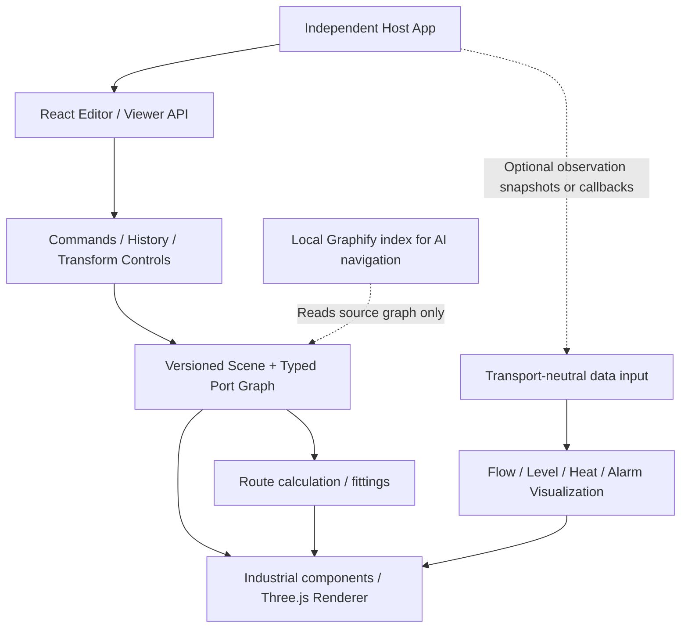
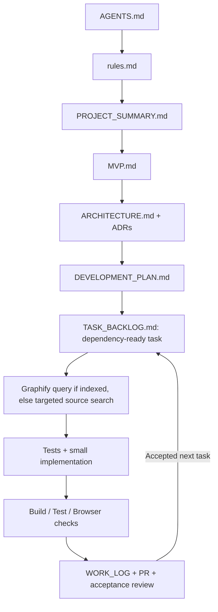

# 3D SCADA SDK — Project Summary & Agent Onboarding

**Document status:** project orientation (source of truth for purpose and scope). **Implementation truth:** code + tested evidence, not this proposal. **Repository:** `sakibcoolz/3d-scada-sdk`. **Read first:** root `AGENTS.md` → `docs/PROJECT_SUMMARY.md` → `docs/MVP.md`.

## Executive summary

This is an independent, installable industrial Three.js SDK for authoring and viewing connected three-dimensional SCADA/process diagrams. It is **not a standalone factory control system**. Another app (including but not limited to Z-Factory) can import its editor and viewer, register equipment, build pipe/port networks, render tank fill or process state, and update visuals using data it already owns. It also provides an R&D playground for building and testing new equipment models.

**No network connection is required**. The SDK must function offline without WebSocket, MQTT, OPC UA, server, authentication, broker or PLC. It should accept static initial state, explicitly supplied observations, or optional host-provided subscription callbacks. The host owns all transports. **No PLC write/control API in MVP.**

## User roles and user journeys

- **Component author:** writes reusable procedural or licensed glTF model with metadata, ports, dimensions and displays; registers it in SDK without editing the host app.
- **Diagram designer:** drags tank/valve/pipe/tee from palette, positions and rotates, snaps compatible ports, routes pipeline, changes material view, undoes mistakes, saves JSON.
- **Process viewer/operator:** loads validated saved scene, orbits/zooms, checks live or static quality-tagged values and observes explicitly supplied flow direction/level without changing industrial equipment.
- **App integrator:** installs versioned packages and passes scene, data and callbacks through public APIs, independent of underlying transport.
- **AI engineering agent:** reads contracts and dependency order, executes one backlog task, tests it and records evidence before proceeding.

## Industrial asset families
Fluid: vertical/horizontal tanks, silos, pipes, elbows, tee/cross junctions, reducers, ball/gate/butterfly valves, pumps, mixers, heat exchangers, filters. Mechanical: motors, conveyors, actuators. Instrumentation: level, temperature, pressure, flow, proximity and switches. **MVP prioritizes tank, straight pipe, elbow, tee, valve, basic pump/sensor placeholders**. Remaining assets are incremental library expansions.

## Product layers



Graphify is optional development tooling, **not an SDK runtime dependency** and does not guarantee accuracy or token savings.

## Separation of concerns
- `core` defines valid, serializable semantic scene and ports, no Three.js/React.
- `components` declares industrial equipment shapes and standardized ports.
- Future `connection-engine` owns compatibility, graph constraints and snapping; `pipe-routing` derives path geometry.
- Future `editor` owns commands, history and user interaction.
- Future `renderer-three` and `flow-animation` draw 3D scene and indicators.
- Future `telemetry` (better described as **host-driven data inputs**) accepts observations and quality flags, **not sockets**.
- `react` exports viewer/editor bindings; `apps/playground` demonstrates examples and runs tests.
- Optional simulation stays logically separated from observed actual values.

## Initial SDK consumer experience (conceptual future API)

```tsx
<Scada3DViewer scene={savedScene} observations={observationsFromHost} />
<Scada3DEditor
  initialScene={savedScene}
  onChange={(nextScene) => persistInHost(nextScene)}
/>
```

Alternatively a future `sdk.setTagValues([...])` push API can be offered. **These exact observation props/API signatures are planned, not yet verified or guaranteed.** No WebSocket startup or login should be triggered by constructing the SDK.

## Development status at documentation baseline
- **Code scaffold exists but is unverified:** pnpm monorepo, packages/core/types, packages/components/catalog, packages/react with R3F viewer/editor prototype, apps/playground.
- **Prototype behavior:** 3D primitives, drag-to-add, component selection/property movement inputs, tank fill control, basic transparent shell, placeholder manual flow indicator.
- **Not yet production-ready:** clean build/test evidence, robust connections/snapping, automatic routing, validated scene migrations, canvas-accurate drop, gizmos, undo/redo, animated moving fluid, real cutaway, data-input API, SDK publishing.
- Never treat a roadmap checkbox, diagram or Graphify node as a tested feature. Verify actual current git branch/code before stating completion.

## Repository map: files, links and flow

| Root/document | Role | Read/related files |
|---|---|---|
| `AGENTS.md` | mandatory start and operating contract | `rules.md`, this file, `MVP.md` |
| `rules.md` | code/architecture/quality non-negotiables | `ARCHITECTURE.md`, `SECURITY_AND_SAFETY.md` |
| `docs/PROJECT_SUMMARY.md` | why, who, what, boundaries and code map | `PRODUCT_REQUIREMENTS.md`, `MVP.md` |
| `docs/MVP.md` | MVP scope, vertical slice, DoD and demonstration | `IMPLEMENTATION_ACCEPTANCE.md` |
| `docs/PRODUCT_REQUIREMENTS.md` | comprehensive FR/NFR catalogue | `DEVELOPMENT_PLAN.md` |
| `docs/ARCHITECTURE.md` | logical modules, data flows, invariant contracts | `DECISION_LOG.md`, `adr/` |
| `docs/DEVELOPMENT_PLAN.md` | phase dependencies and exit gates (M0–M8) | `TASK_BACKLOG.md` |
| `docs/TASK_BACKLOG.md` | task IDs T-001 etc, status and dependencies | `WORK_LOG.md` |
| `docs/IMPLEMENTATION_ACCEPTANCE.md` | test scenarios and pass conditions | `TEST_STRATEGY.md` |
| `docs/SCENE_AND_CONNECTIONS.md` | scene persistence and ports | `COMPONENT_STANDARD.md` |
| `docs/GRAPHIFY_AGENT_REFERENCE.md` | local index and source-backed graph queries | `AGENT_WORKFLOW.md` |
| `docs/AGENT_WORKFLOW.md` | brief → implementation → review → handoff | `WORK_LOG.md`, PR template |
| `docs/WORK_LOG.md` | append-only observed agent sessions | `TASK_BACKLOG.md` |

## Physical code map: current bootstrap

```text
apps/playground/src/main.tsx
   → packages/react/src/index.tsx
       → packages/components/src/index.ts  (equipment catalog)
       → packages/core/src/index.ts        (scene, port interfaces)
```

The mapping is from the scaffold and must be rechecked against HEAD. Intended future separation: `react` → editor/renderer adapters → core, connections, routing and visualization domains. Do not create empty packages just to match documentation.

## Development lifecycle and agent startup



**Starting point for an entirely new agent:** verify branch and repo; read `AGENTS.md`, then the ordered links. Begin `T-001` build verification, not a new tank animation. Complete `T-002` CI/testing before M1. Graphify T-027 is an optional parallel tooling task after T-001.

## Handoff checklist
At session end provide: task ID, exact files/symbols, branch/commit/PR, inputs/outputs affected, Graphify query freshness or fallback, commands run and actual results, acceptance proof, security/coupling risks, incomplete functionality and next dependency-ready task. Append concise history to `WORK_LOG.md`.

## Strategic rules and prohibitions
- No mandatory network stack; no WebSocket or MQTT initiation in SDK constructor/editor/viewer.
- No browser direct PLC/OPC UA, device credentials, physical valve command writes or unsupported certification claims.
- Saved scene has explicit port graph. Screen contact does not automatically mean hydraulic connectivity.
- Flow and heat effects do not claim real-world physics; real vs simulated vs unknown displayed distinctly.
- SVG conversion must be restricted and licensed; SVG cannot infer hidden 3D internals.
- Formal CFD is outside MVP; physical pressure/volume models require explicit equations and test tolerances.
- Release only after consumer-app install, scene migration, typecheck/build and acceptance test evidence.
